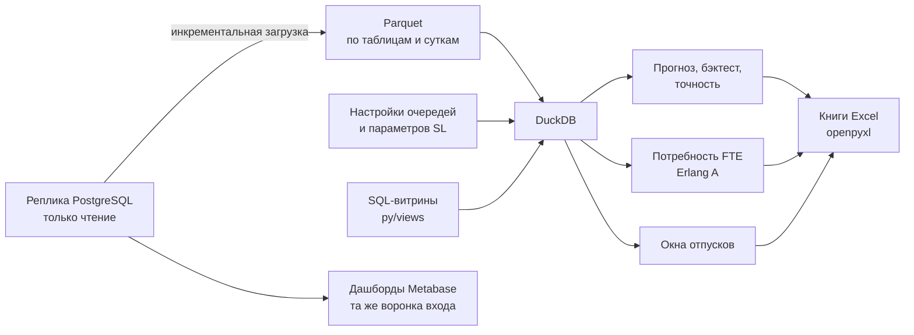

# Contact Center WFM Toolkit

A self-built workforce management toolkit for a contact center: quarterly and annual forecasting at 30-minute intervals, a two-week recalculation, forecast accuracy and backtesting, FTE need with shrinkage (Erlang A), vacation windows, and Metabase dashboards over the same entry funnel.

This public copy is a **generalized demonstration of the approach**. Identifiers, company and product names, hostnames and real business figures have been removed or replaced with placeholders. All datasets in `sample_data/` are **synthetic** and are not production data.

---

# WFM-система для контакт-центра

Консоль на Python, витрины SQL и описание дашбордов. Так я выстраивал WFM-функцию без коробочной системы: от сырых событий платформы контакт-центра до прогноза, расчёта численности и отчётности.

Репозиторий — **обобщённая демонстрация подхода**, а не выгрузка рабочей инсталляции. Данные в `sample_data/` синтетические. Внутренние идентификаторы очередей, названия компании и клиентов, адреса баз и реальные цифры сюда не входят.

## Что делает система

- **Прогноз нагрузки** на квартал и на год с шагом 30 минут: уровень × индекс дня недели × запас на внеплановые всплески × события. Праздники считаются как воскресенье.
- **Еженедельный пересчёт** горизонта на две недели по свежим данным.
- **Точность и бэктест**: сохранённые версии прогноза сравниваются с фактом только по уже прошедшим дням.
- **Численность (FTE)** для голоса и чата — Erlang A (с терпением абонента) с учётом целевого Service Level, перерывов, utilization и shrinkage (плановый и внеплановый абсентеизм). Почта считается часами месяца, без Erlang.
- **Окна отпусков** строятся по готовой годовой потребности и составу, без пересчёта прогноза.
- **Дашборды Metabase** считают ту же воронку входа: Service Level, AHT, ASA, A1RT, CSI, utilization, потери, оперативный экран дня. Состав карточек — в `docs/dashboards.md`.

Автоматическое построение графиков смен и перерывов (CP-SAT) в этот публичный архив **не входило**: здесь — прогноз, потребность и окна отпусков. Калькулятор Erlang A в исходной сборке подключался отдельным модулем, которого в архиве тоже нет; путь поиска описан в `py/need.py`.

## Архитектура



По шагам:

1. Реплика PostgreSQL, только чтение. Пароль берётся из диспетчера учётных данных Windows (или из переменной окружения, не из файлов репозитория).
2. Загрузчик пишет колоночные файлы Parquet: первый прогон — слепок по суткам, дальше — догрузка новых ключей с запасом `OVERLAP_DAYS`. Изменяемые строки чатов версионируются, при чтении берётся последняя версия. Номера телефонов, адреса и имена клиентов загрузчик не забирает.
3. DuckDB читает эти файлы. Витрины лежат в `py/views` и собираются при каждом подключении. На будущее предусмотрен backend `postgres` — своя база с теми же именами таблиц.
4. Меню считает прогноз, численность, отпуска и сверку с фактом. Книги Excel собирает openpyxl.
5. Экраны Metabase считают ту же воронку входа. Живые дашборды в репозиторий не входят, описание карточек — в `docs/dashboards.md`.

Ключевые решения по методологии (прогноз, FTE и абсентеизм, отпуска, архитектура данных) коротко собраны в `docs/decisions.md`. Полный журнал решений не публикуется.

## Меню консоли

Запуск: `wfm.bat` в корне (Windows) или `python py/wfm_menu.py`.

| Пункт | Что делает |
|---|---|
| 1. План на квартал | При необходимости догружает источник → прогноз квартала по 30 мин |
| 2. Недельный пересчёт | То же → прогноз на 2 недели |
| 3. План на год | Календарный год (с июля — следующий). Сам не публикует и уже опубликованный год не затирает |
| 4. Точность | Сохранённые версии против факта, только по уже прошедшим дням |
| 5. Потребность | Квартал (последний опубликованный) или год |
| 6. Отпуска | Окна по готовой потребности года. Прогноз не пересчитывает |
| 7. Настройки | Обновление данных, календарь событий, пароль, публикация, показатели людей |

Пункты 1–4 догружают источник, если данные старше нескольких часов. Пункты 5 и 6 читают уже посчитанные книги.

## Структура папки

```
wfm.bat              — консоль
py/                  — скрипты и SQL-витрины (views/)
docs/                — дашборды и выжимка методологических решений
sample_data/         — синтетические CSV, чтобы было видно входы витрин
inputs/              — календарь событий, need.txt, состав, отсутствия
data/                — хранилище Parquet (создаётся локально, в git не входит)
reports/             — книги Excel по видам: forecast/, need/, checks/
config.example.py    — памятка по настройке
.env.example         — шаблон переменных подключения
```

Имена сырых таблиц в загрузчике и витринах обобщены (`voice_queued_calls`, `chat_session_iterations`, `dim_projects`, `dim_employees` и т.д.). В рабочей системе на их месте были таблицы платформы контакт-центра: подставьте свои имена или заведите представления-синонимы в реплике.

## Как запустить

Нужны Python 3.10+ и зависимости из `requirements.txt`:

```bash
python -m venv .venv
# Windows: .venv\Scripts\activate
# Linux/macOS:
source .venv/bin/activate
pip install -r requirements.txt
```

1. Скопируйте `.env.example` в `.env` и укажите хост, порт, базу и логин реплики. Пароль сохраните через `python py/save_password.py` (Windows Credential Manager) либо, для отладки, задайте `SOURCE_PG_PASSWORD` в окружении, но не коммитьте его.
2. В `py/wfm_settings.py` проверьте список очередей и входов — сейчас там заглушки.
3. Запустите `wfm.bat` и в «Настройках» обновите данные источника. Либо положите синтетические CSV из `sample_data/` в хранилище (см. `sample_data/README.md`).
4. Дальше можно считать прогноз, потребность и отпуска. Без живой реплики и без своего модуля Erlang A пункты, которые ходят в базу или в калькулятор численности, не выполнятся — это ожидаемо.

Разовые проверки, которые в исходной сборке вызывались батниками из `tools/`, запускаются напрямую:

```bash
python py/store_check.py
python py/series_overview.py
python py/import_history.py
python py/wfm_forecast.py --backtest
```

## Стек

Python, pandas, numpy, openpyxl, DuckDB, PyArrow, PostgreSQL (psycopg, только чтение), Windows Credential Manager (keyring), Metabase (описание экранов, не код дашбордов).

## Важно

- Данные в `sample_data/` **синтетические**. Это не история обращений и не показатели какой-либо компании.
- Проект показывает подход: пайплайн, модель прогноза, расчёт FTE и структуру отчётности. Он не является коробочной WFM-системой и не содержит секретов, паролей и персональных данных.
